# Lumen — a liquid-glass home screen for older Samsung Tizen TVs

**Lumen** is an original, ad-free launcher for Samsung smart TVs running **Tizen 2.4 (2016 models)**. It gives an older TV a clean, modern home screen: your favourite apps, HDMI inputs, weather and a big clock on a "liquid glass" design over a scenic wallpaper that follows the sun.

It runs as a normal TV app installed through Developer Mode — **no root, no firmware changes, no exploits**. Everything can be undone by uninstalling the app.

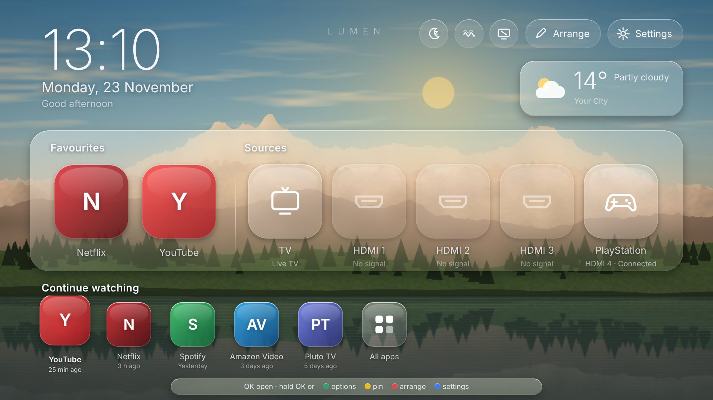

More screenshots below ↓

---

## Features

- **Home screen** — big clock, day, date and greeting; Favourites; all your inputs (TV, HDMI 1–4) with live "Connected / No signal" status; *Continue watching* with "25 min ago / Yesterday".
- **All apps drawer** — every installed app, grouped automatically (Movies & Series, Sport, Music & Radio, Kids & Games…). Pin, hide and reorder with the remote.
- **Scenic wallpaper that follows the sun** — one mountain-lake scene in four lights (dawn, warm day, sunset, night) that changes with real sunrise and sunset times for your city. Four extra wallpapers included.
- **Weather** for your city (free [Open-Meteo](https://open-meteo.com) API, no key needed).
- **Inputs inside the launcher** — open an HDMI input full screen from Lumen; press BACK to come back. Rename inputs ("HDMI 4 → PlayStation") or hide unused ones.
- **Quick buttons** — sleep timer, soundscape, screen off.
- **Soundscapes** — 8 real recordings (rain, thunderstorm, ocean, forest stream, fireplace, birds, summer night, wind) plus brown noise, looped seamlessly.
- **Night mode** — dimmer, warmer colours and a bigger clock at night (time you choose).
- **Screensaver** — full scenic picture with a slowly moving clock after X minutes idle.
- **Hold OK (or GREEN) for options** on any app or input.
- **Liquid-glass settings** — transparency, blur, reflections, edge light, animations, and an **Auto** effects mode that switches to a lighter look if your TV is slow.
- **Backup & restore** settings to the TV's storage or a USB stick.
- **Languages:** English and Azerbaijani (easy to add more — see `STR` in `app.js`).
- **No ads, no tracking, no account.** The only network request is the weather.

### Remote control

| Button | Action |
|---|---|
| Arrows / OK | Move / open |
| Hold OK or 🟢 GREEN | Options for the selected app or input |
| 🟡 YELLOW | Pin / unpin favourite |
| 🔴 RED | Arrange favourites (in the drawer: hide app) |
| 🔵 BLUE | Settings |
| BACK | Close / go back (never exits Lumen) |

---

## Screenshots

| Home — day | Home — dawn |
|---|---|
|  | 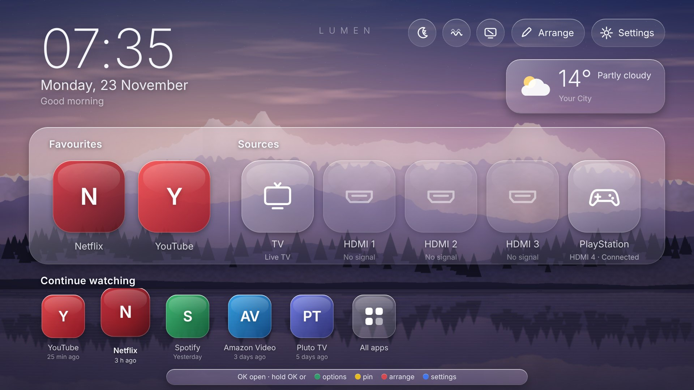 |
| **Home — sunset** | **Night mode (22:00–07:00)** |
| 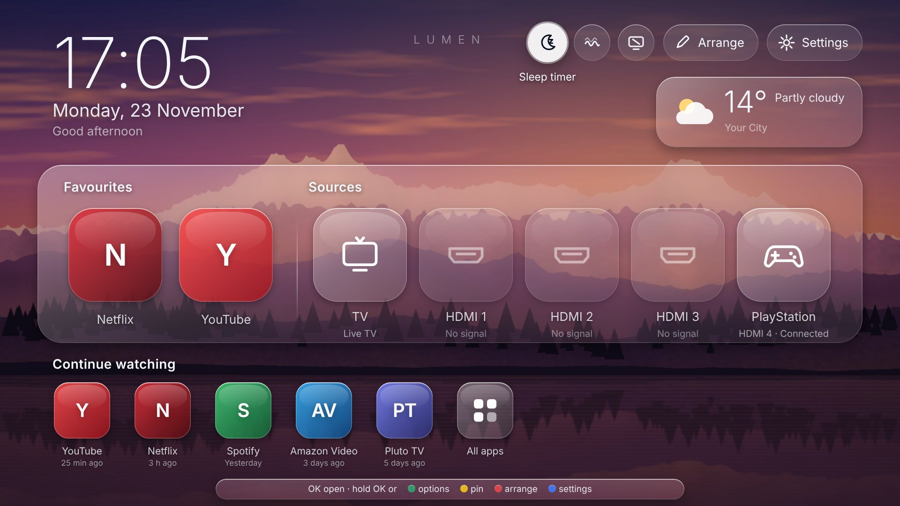 | 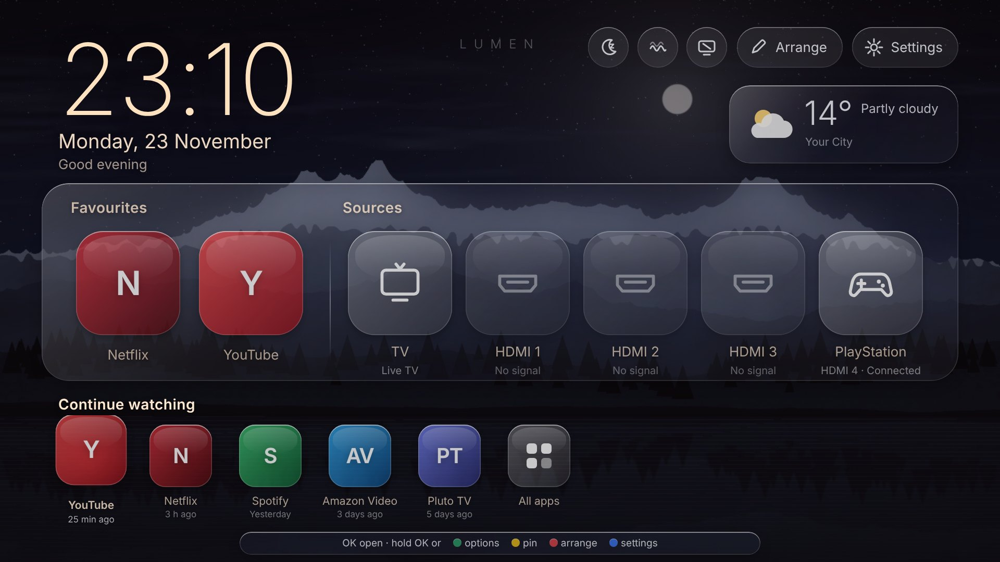 |
| **All apps, grouped** | **Arrange favourites** |
| 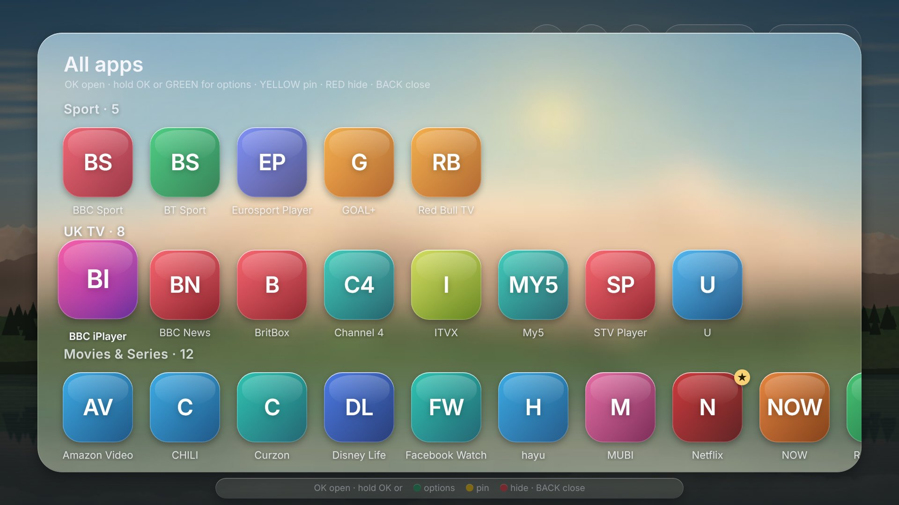 | 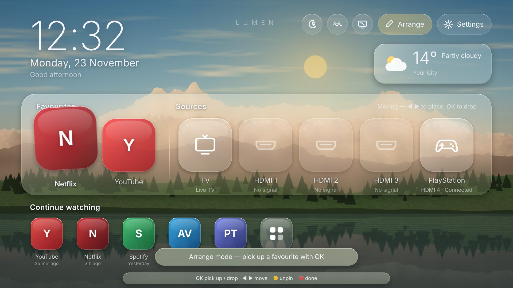 |
| **Hold OK — app options** | **Rename an input** |
| 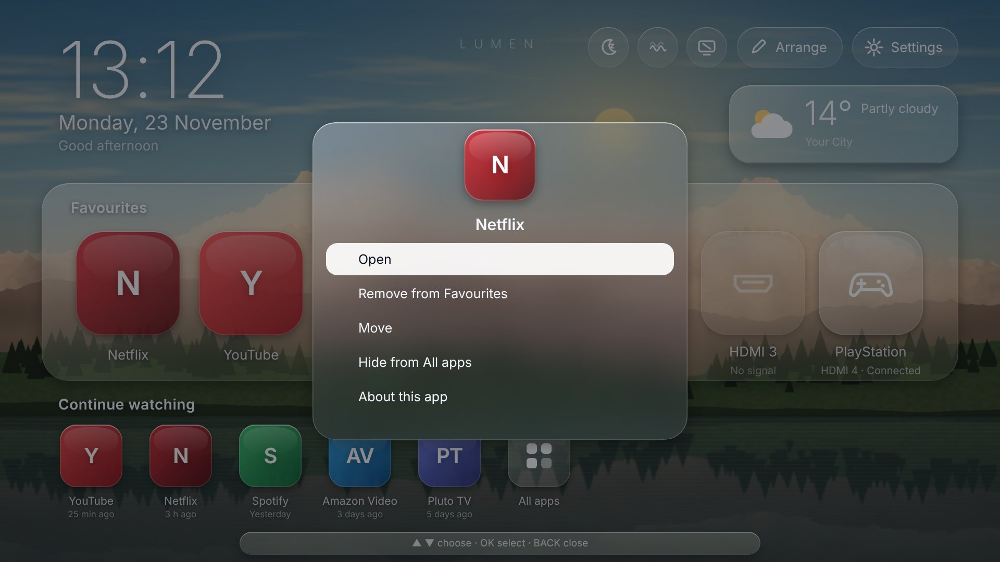 | 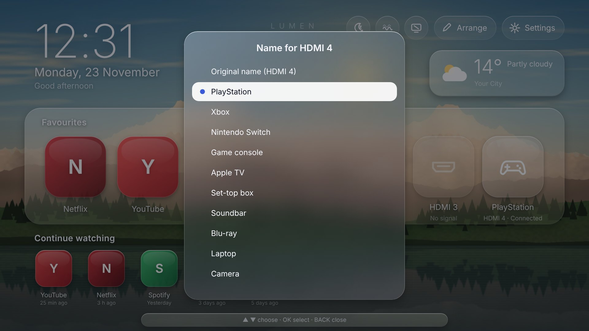 |
| **Soundscapes** | **Sound credits** |
| 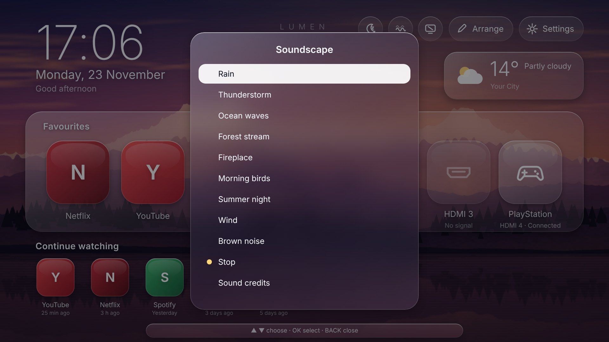 | 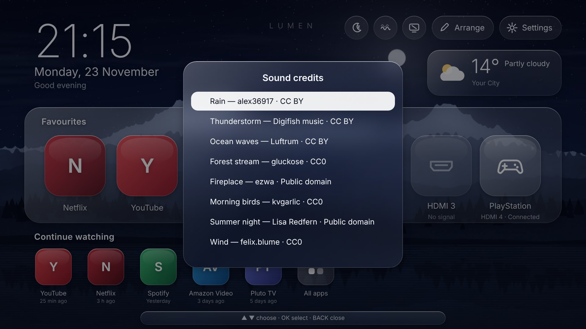 |
| **Sleep timer** | **Screensaver** |
| 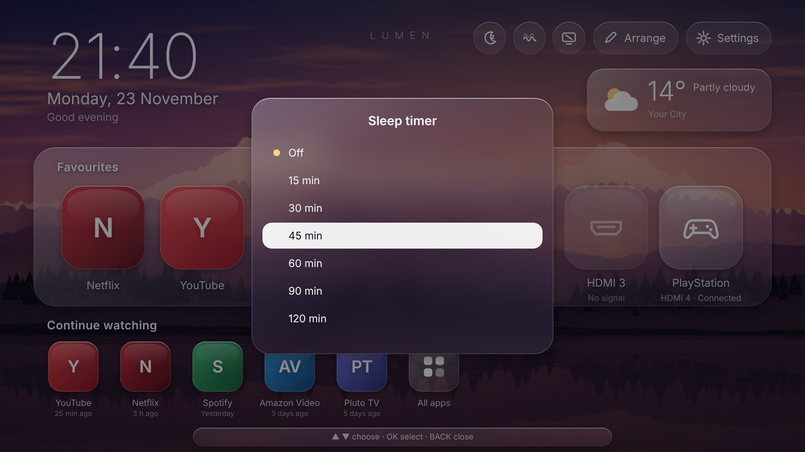 | 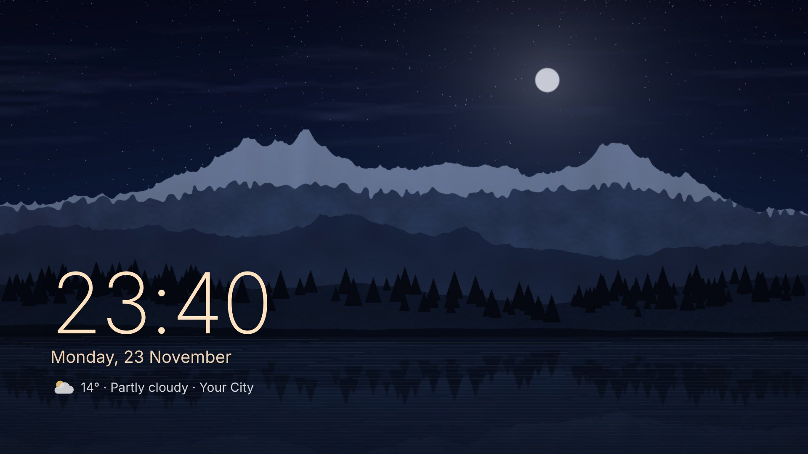 |
| **Settings** | **Azerbaijani language** |
| 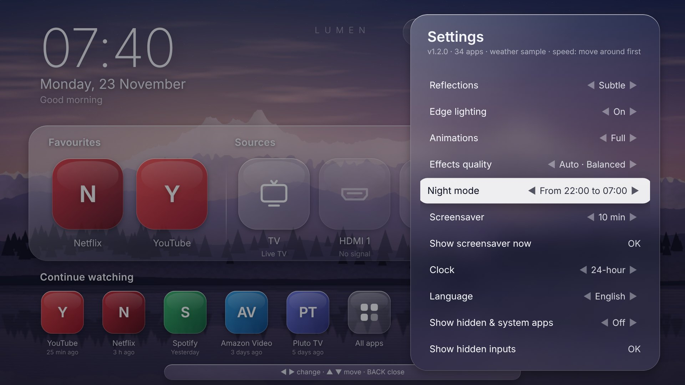 | 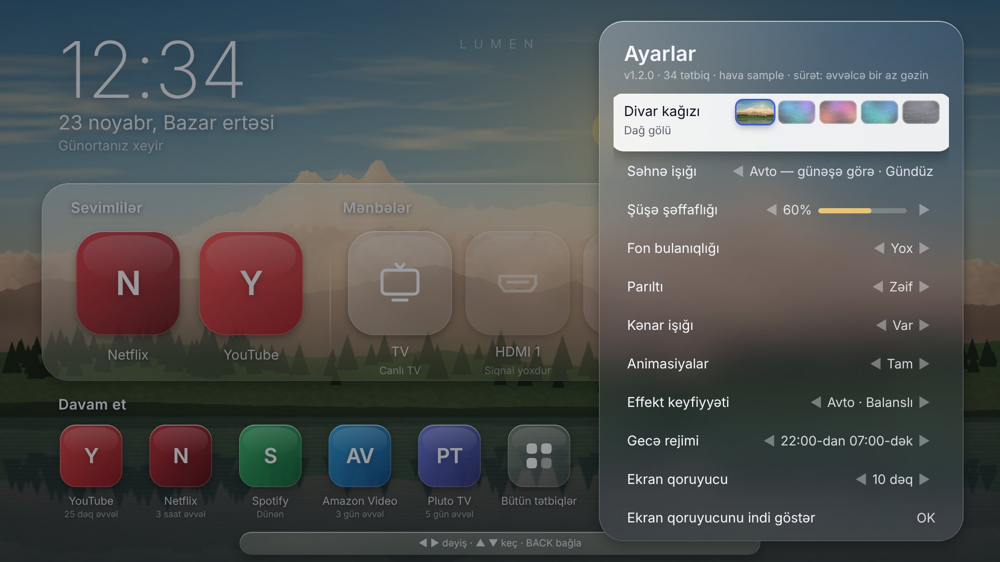 |

*Screenshots are from the browser preview with sample apps; on the TV your own apps and icons appear.*

---

## What it can and can't do (honest limitations)

- **It does not replace Samsung's Smart Hub or the Home button.** Samsung reserves the Home key for the system on these TVs, and third-party apps cannot become the default home screen without root. Lumen is an app that *opens itself at power-on* (see [Start Lumen when the TV turns on](#start-lumen-when-the-tv-turns-on)).
- Samsung's own menus (Settings, Source list) are unchanged.
- Apps cannot see what is playing inside other apps, so *Continue watching* shows apps, not individual shows.
- "Screen off" blacks out the picture; whether the backlight fully switches off depends on the model.

---

## Compatibility

| | |
|---|---|
| Built and tested on | Samsung 2016 TV, **Tizen 2.4** (web engine WebKit 538) |
| Should work on | Other 2016 Samsung TVs (K series) — please report results |
| Newer Samsung TVs (2017+) | Probably work, not tested |
| Code style | Plain ES5 JavaScript, no CSS variables / grid / backdrop-filter, so it runs on old TV browsers |

---

## Requirements

- A Samsung Tizen TV and a Windows, macOS or Linux PC **on the same network**.
- [Tizen Studio](https://developer.tizen.org/development/tizen-studio/download) (the CLI is enough) — it provides `sdb` and the `tizen` command.
- Python 3 with `cryptography` and `lxml` (`pip install cryptography lxml`) — only for the SHA-256 signing tools below.

---

## Installation

> Replace everything in **[BRACKETS]** with your own values.

### 1. Turn on Developer Mode on the TV

1. On the TV, open **Apps**.
2. Press **1 2 3 4 5** on the remote.
3. Turn Developer Mode **On** and enter your PC's IP address as Host IP: `[YOUR PC IP ADDRESS]`
   (find it with `ipconfig` on Windows or `ip addr` on Linux/macOS).
4. Restart the TV completely (hold the power button, or unplug it for 60 seconds).

Find the TV's IP address under **Settings → General → Network → Network Status → IP Settings**: `[YOUR TV IP ADDRESS]`

### 2. Connect from the PC

```
sdb connect [YOUR TV IP ADDRESS]:26101
sdb devices
```

`sdb devices` lists your TV, e.g. `[YOUR TV IP ADDRESS]:26101  device  [YOUR TV DEVICE NAME]`. You'll use that device name below.

> On Windows, `sdb.exe` is in `C:\tizen-studio\tools\` and `tizen.bat` in `C:\tizen-studio\tools\ide\bin\`.

### 3. Set your city (optional, for weather and sunrise/sunset)

At the top of `app/app.js`:

```js
var CITY = { name: '[YOUR CITY]', nameAz: '[YOUR CITY]', lat: [YOUR LATITUDE], lon: [YOUR LONGITUDE] };
```

Leave `lat` / `lon` as `null` to hide the weather card.

Optionally change the app's identity in `app/config.xml`: `id="http://[YOUR NAME].local/Lumen"`.

### 4. Sign the package (important for 2015–2016 TVs)

Current Tizen Studio versions sign apps with **SHA-512**, which **Tizen 2.3/2.4 TVs reject** (typically install error **118** or an install that never finishes). The tools in `tools/` produce the same signature layout as Tizen Studio, but with **SHA-256**.

**a) Create your author certificate once** — signed by the *Tizen Developers CA* that ships with Tizen Studio:

```
python3 tools/make_author_cert.py \
  [TIZEN STUDIO]/tools/certificate-generator/certificates/developer/tizen-developer-ca-privatekey.pem \
  [DEVELOPER CA KEY PASSWORD] \
  [TIZEN STUDIO]/tools/certificate-generator/certificates/developer/tizen-developer-ca.cer \
  keys  [YOUR NAME]
```

The developer-CA key password is in `[TIZEN STUDIO]/tools/certificate-generator/certificates/developer/conf.ini`. This creates `keys/author-key.pem` and `keys/author-cert.pem`.

> **Keep the `keys` folder safe and private.** Every future update must be signed with the same author key, or the TV will refuse it (you'd have to uninstall first and lose your settings). Never commit it to GitHub — `.gitignore` already excludes it.

**b) Sign and package:**

```
python3 tools/sign_wgt.py --src app --out lumen.wgt \
  --author-key keys/author-key.pem --author-cert keys/author-cert.pem \
  --dev-ca [TIZEN STUDIO]/tools/certificate-generator/certificates/developer/tizen-developer-ca.cer \
  --dist-p12 [TIZEN STUDIO]/tools/certificate-generator/certificates/distributor/tizen-distributor-signer.p12 \
  --dist-pass [DISTRIBUTOR P12 PASSWORD]
```

This distributor certificate is the public test certificate bundled with every Tizen Studio install; its password is a fixed, publicly documented test value (not a personal secret).

**c) Check it (optional):** unzip `lumen.wgt` into a folder and run
`python3 tools/verify_sig.py [FOLDER]/author-signature.xml [FOLDER]`.

### 5. Install and run

```
tizen install -n lumen.wgt -t [YOUR TV DEVICE NAME] -- [FOLDER CONTAINING lumen.wgt]
tizen run -p LumenTV001.Lumen -t [YOUR TV DEVICE NAME]
```

Use `tizen install` rather than calling the TV's installer manually over `sdb shell` — manual installs can hang the TV's installer (see Troubleshooting).

### Config rules that matter on Tizen 2.4

These are already correct in `app/config.xml`; keep them if you edit it:

- No spaces in the app `<name>`.
- `required_version="2.4"` and **no** `tizen:profile` element.
- Do **not** add the `application.info` privilege — the app list works without it, and it breaks installation on these TVs.

---

## Start Lumen when the TV turns on

1. On the TV, go to **Settings → System → Expert Settings**.
2. Turn on **Autorun Smart Hub** and **Autorun Last App**.
3. Open Lumen and leave it on screen when you turn the TV off.

Next time the TV turns on, Lumen opens. Lumen never exits on BACK, so it stays the "last app" as long as you return to it.

You can also pin Lumen first in Smart Hub (**Apps → Lumen → Options → Add to Home**, then **Move** it to the first place), so **Home → OK** always gets you back.

---

## Uninstall / undo everything

```
tizen uninstall -p LumenTV001.Lumen -t [YOUR TV DEVICE NAME]
```

Then turn off **Autorun Last App** and Developer Mode if you like. Nothing else on the TV is changed.

---

## Troubleshooting

| Problem | Fix |
|---|---|
| `failed to connect` | Your PC's or TV's IP address changed. Check both, update the Developer Mode Host IP on the TV, restart the TV. A DHCP reservation in your router prevents this. |
| Install error **118** / signature errors | Package was signed with SHA-512 or a mismatched certificate — use `tools/sign_wgt.py`. |
| Install hangs, TV becomes sluggish | Unplug the TV for 60 seconds, then install with `tizen install` (not manual `sdb shell` commands). |
| `sdb install` complains about a temporary path | Use `tizen install`; if you push manually, `/opt/usr/apps/tmp/` works on these TVs. |
| Update refused | It wasn't signed with the same author key as the installed version. |
| Developer certificate expired | The Tizen Developers CA expires on 1 January 2027; author certificates can't outlive it. After that date, newly signed packages may be refused. |

---

## Project structure

```
app/                 the TV app (copy this folder into the package)
  config.xml         Tizen widget config
  index.html  app.js  glass.css
  wall/              wallpapers (full, soft-blur, frost-blur and thumbnail versions)
  sounds/            soundscape loops + CREDITS.md
tools/
  sign_wgt.py        SHA-256 package signer for Tizen 2.3/2.4 TVs
  make_author_cert.py  creates an author certificate signed with SHA-256
  verify_sig.py      checks a package signature
  make_wallpaper.py  generates the scenic wallpaper in four lights
docs/screenshots/
```

**Preview in a browser:** open `app/index.html` in Chrome. Without a TV it runs with sample data and an on-screen remote (keyboard: arrows, Enter — hold for options, Esc, R/G/Y/B).

---

## Credits

- **Sounds:** recordings from the [Blanket](https://github.com/rafaelmardojai/blanket) project's sound library — CC0, public domain and CC BY. Authors and licences are listed in [`app/sounds/CREDITS.md`](app/sounds/CREDITS.md) and inside the app (Soundscape → Sound credits). Clips were trimmed, loudness-normalised and crossfaded into seamless loops.
- **Weather:** [Open-Meteo](https://open-meteo.com) (free, no API key).
- **Wallpapers:** original, generated by `tools/make_wallpaper.py`.

## License

Code: MIT — see [LICENSE](LICENSE). Sounds keep their own licences (see credits).

## Disclaimer

Not affiliated with or endorsed by Samsung. Samsung, Tizen, Netflix, YouTube and other names are trademarks of their owners. Use Developer Mode and sideloaded apps at your own risk.
